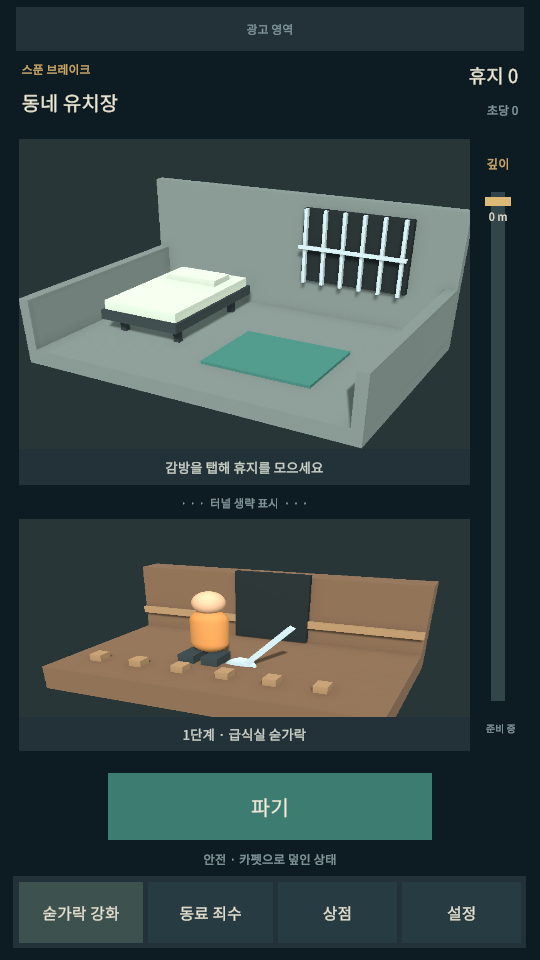

# Project-SpoonBreak

Unity project: repository root (`D:/Project-SpoonBreak`).

- Editor: **6000.3.27f1**
- Template: **Universal 3D** (`com.unity.template.urp-blank`)
- URP: **17.3.0**
- Unity Pipeline: **0.9.1-exp.1**
- Verified CLI: **1.0.0-beta.14**
- Platforms: **Android + iOS**, portrait orientation
- Startup scene: **Assets/Scenes/MainScene.unity**

Open the `D:/Project-SpoonBreak` directory in Unity Hub, or use PowerShell:

```powershell
unity open D:/Project-SpoonBreak
unity status --project-path D:/Project-SpoonBreak --format json
unity command editor status --project-path D:/Project-SpoonBreak --format json
```

The Editor must be running for Pipeline commands. On initial open, acknowledge any URP material upgrade notice in the Editor.

The basic scene contains a prison cell, digging face, fixed cameras, and Korean uGUI with safe-area support. Gameplay and ads are not connected yet. See [scene setup](docs/SCENE_SETUP.md) for hierarchy, temporary values, and verification scope.

Android Build Support (SDK, NDK, OpenJDK) and iOS Build Support are installed for 6000.3.27f1. iOS final builds and signing require macOS with Xcode.


